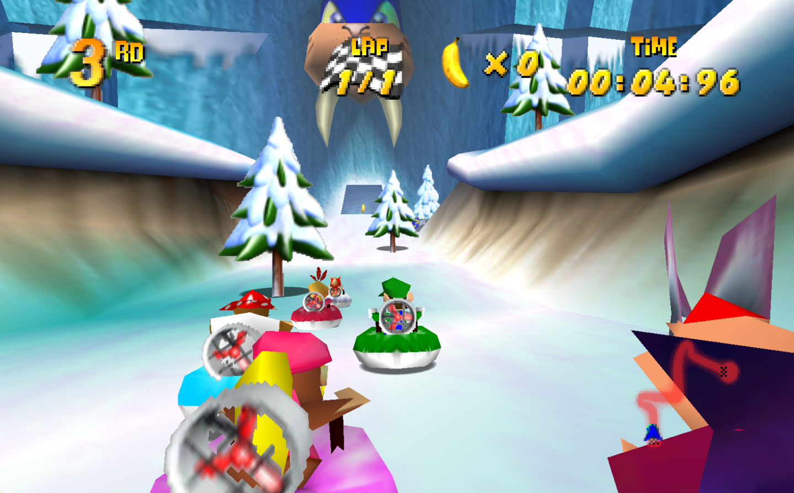

# Bluey - Snow Race v1

An eight-racer, one-lap hovercraft sprint down Bluey's snowy boss course, with 9 bananas across six spots.

**Download both files:**
- [Bluey course ZIP](../packages/Bluey-Snow-Race-v1.zip?raw=1)
- [Required sprint companion 0.3.8](../packages/Bluey-Sprint-Companion-0.3.8.nrm?raw=1)



## Requirements

Use **DKR-R 1.0.15 or later**, your own **US v1.0 (us.v77) or US Rev A/v1.1 (us.v80)** game data, and offline single-player. The actual Windows playtest used 1.0.15 and US v1.0. US v1.1 is declared by the companion and covered by code-level tests, but no new audible v1.1 playtest is claimed here. Later runtime versions have not been tested.

No separate ROM, ROM patch or separate profile is required. Keep one edition of this course and one edition of the sprint companion selected. Other mods may stay installed; compatibility with every enabled combination is not established.

The course's internal ID and provenance still say us-v80 because that is the source revision. They have been preserved rather than changing the tested bytes.

## Install

1. Keep an older copy for rollback. Import **Bluey-Snow-Race-v1.zip** as a DKR-R custom track, then prepare/enable it for the selected Game Pak.
2. Import **Bluey-Sprint-Companion-0.3.8.nrm** as a Custom Magic Code.
3. Choose **Use this edition** for version **0.3.8**, approve it, and turn on **Enabled for next game**.
4. Set **Experimental sprint finish (0 off, 1 on)** to **1**, then **Save settings**. It defaults to 0. Importing the file or setting this number alone does not enable the package.
5. Fully close and reopen the game. Enable Session mods and select **Bluey - Snow Race** in Custom Tracks.

The companion retains its tested internal name, "Standalone Sprint Finish, Stop and Normal Music (Bluey dual-US music candidate)", and package ID `dkr_standalone_sprint_finish_experimental`. It is the same companion family as Tricky 0.3.5, not a second independent code. Select 0.3.8 for this Bluey release; do not expect two editions of that ID to run together. The source also recognises the scoped Tricky course, but this release does not establish a new full Tricky regression pass.

For diagnosing conflicts, temporarily disable other code mods that alter music, laps or finishing. Keep unrelated installed tracks and saves. A backup/test profile is optional, not a separate-ROM requirement. To roll back, select the previous course and matching companion edition.

## What changed and what was tested

The course ZIP is byte-identical to the reduced-banana Bluey course used in the private playtest. The companion is the exact 0.3.8 payload, with no rebuild or gameplay change for publication.

- The user reported **five consecutive restarts with normal-speed music each time** on Windows, after 0.3.8 was installed, selected and enabled. This is a reported playtest result, not a claim that every timing or mod combination has been tested.
- Two separate isolated launches of official Windows DKR-R 1.0.15 on US v1.0 accepted the exact companion, logged its activation, and resolved Bluey's course identity. Lap Banners + Swish 1.1.1 was also enabled for those startup checks.
- Two SDK builds reproduced identical companion bytes.
- Host tests, including ASan/UBSan, passed 1,992 counted cases per supported US revision per test mode.
- Exact packaged-code interpreter tests passed 53 scenarios for each US revision. These use synthetic memory/services, not the full native audio engine.

The companion suppresses the unwanted early final-lap request and retains the existing scoped CPU-finish/post-line-stop behavior. It does not contain replacement music. Already-fast music is not repaired mid-race: start a fresh race after enabling it.

Full human-finish/results coverage, every CPU finish/stopping case on US v1.0, arbitrary mod combinations, online play and split-screen are not verified by this release. Online play is explicitly unsupported. The source-level catalogue gate and VM-fault cleanup limitations remain; the five successful restarts do not eliminate every possible failure mode.

## Contents, source and rights

Course: manifest, header and object-map additions referencing the game's stock Bluey geometry. Companion: NRM code package. No full ROM, game executable, soundtrack or external texture pack is included.

[Companion source](../magic-codes/standalone-sprint-0.3.8/) and [verification record](../validation/BLUEY-V1.json) are provided for inspection. The course manifest's existing "Local preparation" author is retained. Adaptation published by stasipantsis123; original game/course by Rare/Nintendo. Unofficial community content, with no claim of endorsement or license to the original game content.

## Exact payloads

```text
3755d7c1cf567e3f477c0e96f07f9b733a3d0d5015c6e09978a7740b5feb5140  Bluey-Snow-Race-v1.zip
93d7a58177a65ae4662e1429380138f7a87c25d04373ce959f54a1bffdb80bd1  Bluey-Sprint-Companion-0.3.8.nrm
```
