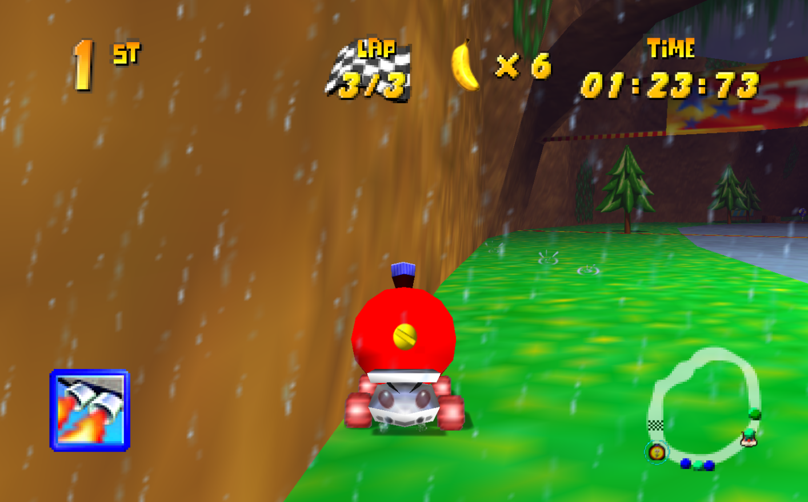

# Original Ten Minimap Icons v1.2.1

See who’s where at a glance! This mod replaces the original racers’ minimap markers with character portraits, making it easier to follow the pack and spot your rivals during a race. Your portrait has a cyan ring. Custom characters without their own compatible icon keep the usual dot or arrow, so everyone can race together. Optional cosmetic only; gameplay is unchanged.

[Download the mod (.nrm)](../packages/Stasi-Original-Ten-Minimap-Icons-1.2.1.nrm?raw=1) · [ZIP with instructions, credits and checksums](../packages/Stasi-Original-Ten-Minimap-Icons-1.2.1-Release.zip?raw=1)



## Install
Use stock DKR-R **1.0.15**, your own supported US game data (us.v77 or us.v80), and offline play.
1. Download the .nrm, or extract it from the release ZIP.
2. In **Custom Magic Codes**, import it, select version **1.2.1**, approve if prompted and enable it.
3. Disable other minimap implementations, keep **Session mods ON**, and restart DKR-R.
No typed code, separate client or engine replacement is required. Keep your existing mods and saves. Compatibility with every possible mod combination is not claimed.

## Custom characters
The original ten racers, including T.T. and Drumstick, have upright portraits. Custom racers without a compatible enabled optional icon retain their normal human-player arrow or CPU dot; they do not inherit the donor character’s portrait. Optional custom icon companions are separate and are **not included**. This release does not promise a completed creator-tool workflow.

## Tested scope
Stasi reported successful Windows play in the normal client, including a custom map and Mario. Screenshots show custom-player arrows alongside CPU portraits; another shows portraits and coloured dots coexisting. An isolated Kazooie test also passed. These are scoped gameplay reports, not exhaustive platform, renderer, vehicle, finish/shutdown or arbitrary-mod certification. SDK/CPU checks cover both US revisions. Optional companion gameplay and broader coverage remain follow-up tests. The distributed NRM is byte-identical to the tested 1.2.1 file.

## Disable
Disable dependent optional companions first if installed, then disable this core and restart. To roll back, select a retained older edition with only one minimap implementation enabled. No ROM or save edits.

## Credits and rights
Stasi supplied the MKPC minimap artwork, icon selection, design direction and playtest feedback. DKR-R contributors supplied the SDK; its exact MIT notice is included in the release ZIP. This notice covers SDK material and does not grant new artwork or character rights. Unofficial community cosmetic; no endorsement is claimed.

## SHA256
```text
b920990c2806bd03d46800573474df6512192aa03504cfef218c15109579b86d  Stasi-Original-Ten-Minimap-Icons-1.2.1.nrm
a706b62dffdf814763cf46b3e36c5253937dc5ed0625d59ac671336596721f02  Stasi-Original-Ten-Minimap-Icons-1.2.1-Release.zip
```
