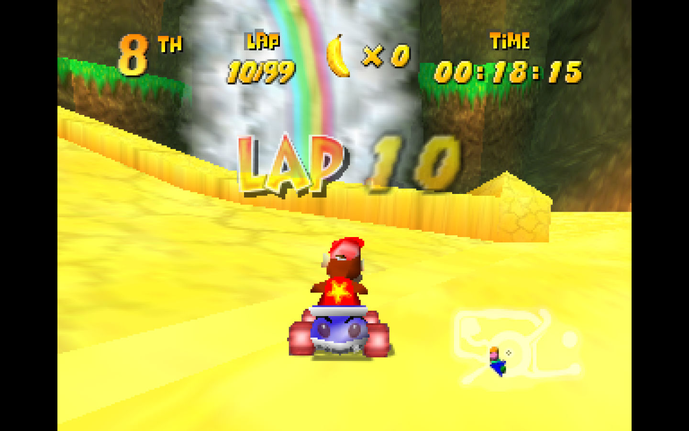

# Universal Silent Lap 3–98 Banners v1.0.0

A Custom Magic Code for DKR-R 1.0.15 or later. Adds the original **LAP** artwork and native HUD numerals on intermediate laps, with compact two-digit spacing and no added voice.

[Download the NRM](dkr_universal_lap_banners.nrm?raw=1) · [Installation and scope](README.txt) · [Validation report](TEST-REPORT.txt) · [Build from source](BUILDING.txt)

## Supported scope

- Offline single-player races with **4–99 laps**, using the standard lap HUD.
- Ordinary, boss, Taj and Time Trial lap races, with no track-name or vehicle restriction.
- **Native Lap 2 and actual Final Lap stay unchanged.** A four-lap race gets LAP 3, then native Final Lap. A 99-lap race gets intermediate numbers through LAP 98, then native Final Lap.
- Does not set race length. Tested alongside official **Custom Trophies Creator 1.0.2**, which can set 1–99 laps per cup round.

Online, split-screen and non-lap modes are not supported in v1. Mods replacing the same HUD hooks may conflict. US v77 and v80 are declared; native testing used Linux 1.0.15 with US v80. Corrected 10, 11 and 20 were visually checked; 98 has automated layout and native draw-log evidence, but no corrected screenshot. Every course, Windows, and full 99-lap completion have not been tested. See the validation report for the precise coverage and remaining limits.

## Preview

Unedited native screenshot using the final v1 package and Custom Trophies Creator. A private presentation fixture advanced the lap state; this is not evidence of a full 99-lap drive.

## Install

Open **Installed Mods → My Mods → Custom Magic Codes**. Choose Import mods and select **dkr_universal_lap_banners.nrm**. Set Status to **All**, open the code’s **Details**, tick **I trust this code mod**, choose **Approve code**, then tick **Enabled for next game**. Start a fresh game with Session mods on. Import the NRM only, not the source folder or ZIP.

The adjacent Magic Codes panel contains stock cheats. The **On** status filter hides a new import until it is enabled. [See the illustrated installation guide](INSTALL.txt).

The package contains code only. It reads artwork from your own configured game data. No ROM, original assets, executable, save, test fixture or third-party trophy package is included.
